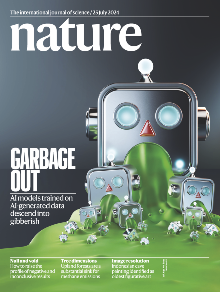
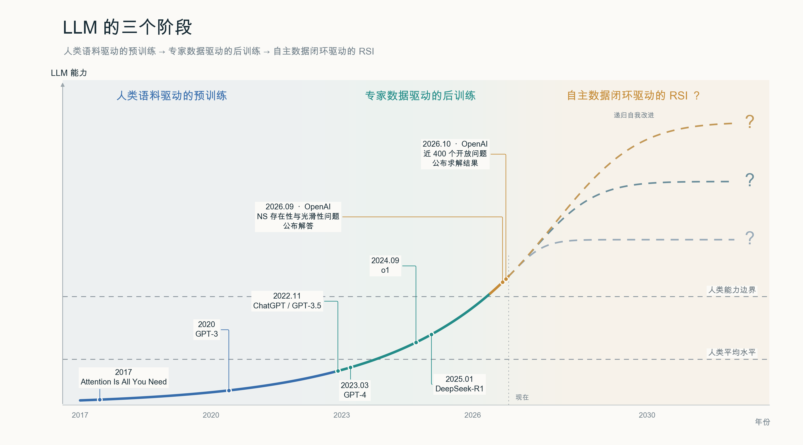
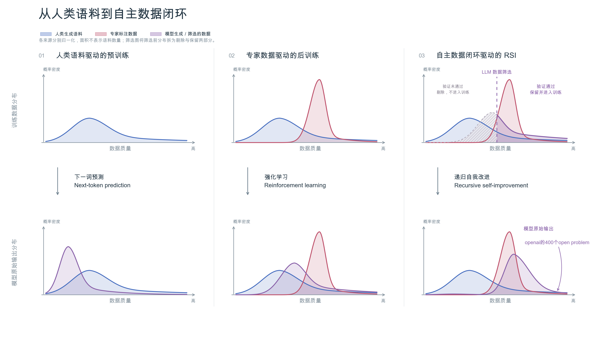
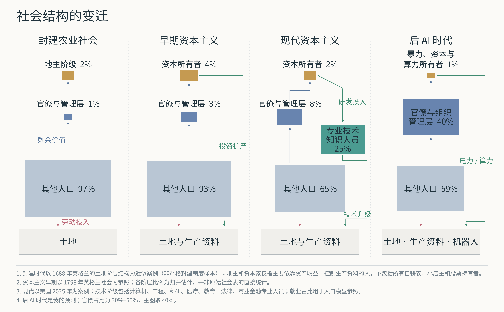

本文主要涉及我三个观点：

1. AI能够自己筛选、清洗数据是RSI发生的基础。
2. 超过大部分人智力的AI将导致世界范围的『沙特化』
3. 后AI时代下，本做题蛆的一些迷茫。

## 为什么 AI 可以通过自己的输出不断进化

相信不少人都对《Nature》2024 年 7 月 25 日那一期的封面有印象：机器人吐出绿色的呕吐液，这些呕吐液被喂给后代模型，导致模型越来越垃圾。研究讨论的现象叫模型崩溃（model collapse）：不加筛选地用前代 AI 生成的数据训练后代模型，会使模型逐代丢失原始数据分布的信息，输出质量和多样性随之退化。

这样的设想非常直观，且令人安心，毕竟『AI 怎么可以左脚踩右脚，越变越聪明呢？』很遗憾的是，最近发生的递归自我改进（recursive self-improvement，RSI）粉碎了这一观点。AI 真的可以在人类不干预的情况下自我进化。

这一转变的核心就在于『不加筛选地用前代 AI 生成的数据训练后代模型』中的『不加筛选』。AI 能够自己筛选、清洗数据，是 RSI 发生的基础。

一个基本的事实是，相比于从头解决一个复杂的数学问题，验证一个证明是否正确相对容易。如果一个模型具有验证证明是否正确的能力，它就可以针对这个问题不断地提出证明方法，对它们一一验证，直到找出正确的那个（如果找不到，就换一个简单点儿的）。然后，这条正确的思考路径就可以成为模型下一轮训练中需要奖励的路径。也就是说，模型自己完成了数据清洗。事实上，这也是 OpenAI 最近把数学、理论计算机和理论物理中的 open problem 当训练数据刷的原因。

在上述认识的基础上，我们可以把大语言模型（LLM）的发展史分为三个阶段：

1. 人类语料驱动的预训练：以人类文明已有的语料为训练数据，学习语言层面的逻辑能力；
2. 专家数据驱动的后训练：以专家标注的数据为训练数据，学习人类的 taste 和长任务（复杂科学问题、大项目代码编写）规划能力；
3. 自主数据闭环驱动的 RSI：通过 AI 自己验证、清洗数据，超出人类的能力边界。（国模提前达到了用更强模型验证、清洗数据的阶段，更早实现了 RSI，赢！）

*这个图是 ChatGPT 画的，没有A畜的贡献似乎也挺合理*

上图包含我个人的假设：RSI 也是会有 ceiling 的，就像自然界中任何指数增长都是限制因素显现前的近似，类似于我们高中学过的种群数量 S 型增长模型。但这个 ceiling 必然在人类能力边界之上。

*AI 筛选训练数据也部分解释了为啥 AI 越来越不讲人话*

上述对 RSI 的理解主要停留在数据层面。另一种理解方式是让模型自己改进架构，比如刘子鸣老师在做的元模型。

按照我的理解，模型能力的上界取决于训练它用到的数据。架构层面的创新能让公司消耗更少的算力，将数据压缩到更小的模型中，但不能突破数据带来的能力上界。假如有无限算力，训练一个极宽极深的全连接网络，它应该能自发形成类似 attention 的结构。

从目前基模训练的岗位构成来看，数据的重要性远超架构。在 RSI 中，大模型自行筛选数据所起的作用，也远超过大模型优化自身架构。当然，对于 LLM 这样一块庞大的蛋糕，在任何地方做出改良，都能带来可观的收益。

## RSI 实现的社会影响

如果仅需支付低廉的电力边际成本，就能够获得超过大多数人类能力边界的智能，这对我们的社会意味着什么？我认为，技术阶级作为一个整体会从人类社会中退场，新形成的社会结构将分为三层：垄断暴力和算力的统治集团、服务于统治集团的庞大官僚集团，以及从事体力劳动的机器人和工人。这可以类比于当前的中东石油国家：垄断石油收益的王爷、吃福利的本国公民和干苦力的南亚劳工。聪明的你可能已经看出来了，这更类似于封建主义。这里我们不妨回顾一下历史。

回到 1769 年，为什么资本主义替代了封建主义？在农业时期，土地和劳动是唯二的要素，土地是不能再生产的。在工业革命后，生产资料和劳动力是要素，而生产资料是可以再生产的。资本家和地主都会雇佣工人。与把剩余价值都用在享受和维护统治上的地主相比，资本家会把一部分剩余价值用来进行生产资料和人力资本的再生产，并投资可能提高生产率的新技术。

在生产资料的积累饱和之后，资本家们先决定在海外碰碰运气，这就是帝国主义。后来发现这条路走不通，于是决定将剩余价值的大部分用于先进技术与组织方式的研发，小部分用于豢养一批看似在工作的臃肿公共组织（那些决定用大部分剩余价值豢养官僚的国家，冷战后破产了），再留下一些给底层人民兜底。这样的分配方式催生了对工程师、白领、科学家的需求，并鼓励人力资本的再生产，构成了我们现在看到的资本主义。

在过去，所有行业都同时需要劳动力和资本。根据对两者需求的不同，行业可以分为劳动力密集型和资本密集型。在 RSI 乃至具身智能实现的未来，可能所有行业都只需要少量劳动力和大量资本：现有类型的生产资料，以及利用电力转化而来的人工智能 token。这样一来，人力资本的再生产就不再是必需的了，对技术进步的投资也变成了 AI 巨头资本开支的一部分，不再能为人类提供工作岗位。

于是在未来，我们或许会看到世界变得『沙特化』：少部分『王爷』垄断了暴力、资本和算力；一批组织管理人员凭借各种各样的关系跟着喝口汤，并假装自己在工作；其余人则主要靠 AI 带来的空前物质产出所支撑的低保生活。其实第二类人和第三类人也没有本质区别。毕竟，用世界首富马斯克先生的话来说，人类只需要等着退休，再发展点类似 gardening 的爱好就好了。

## 如果思考变得廉价，我希望成为一个什么样的人

首先是个人职业规划方面。至少在前年之前的规划中，我是要成为技术阶层中的一分子，靠某个方向的 expertise 混口饭吃的。可惜，400 个 open problem 的解决标志着数学、理论计算机、理论物理领域的死亡。反正我看到的是，我们专业比我高的连续三个年级中，最优秀的同学都转行了。有学长看到自己关注并尝试解决了几年之久的 open problem 被 OpenAI 爆破，心灰意冷，决定去量化赚点快钱；有学长看到 LLM 给物理带来的巨大冲击，决定自己也去 frontier lab 里面看看他们在做啥。当然，我也很眼红传闻中的大结果。

更重要的冲击在身份认同方面。过去，我追求的是相对的自由，而自由建立在一定程度的『不可替代性』之上：这件事情只有我能干，所以你有求于我，所以我们是相对平等的关系。当然了，这也可能只是具有本人特色的力工思维的幌子罢了（哈哈哈哈）。不过，现在我能干的活儿 AI 大人都能干，这让我不得不更多地关注我作为一个『人』独有的特质：如何与他人建立联系，如何帮助更多的人，如何扩大个人影响力（俗称炒作）。

本来我还想写很多东西，有关我的思想斗争，有关我的最终决定，有关到底要不要跑路，有关我对两个行业的看法……不过，计划总是赶不上变化。现在，很多原本做好的决定又变得不确定起来。

总之，在这里与所有曾经想成为技术阶级、现在陷入迷茫的做题蛆们共勉！希望我们能在新时代找到属于自己的位置！
