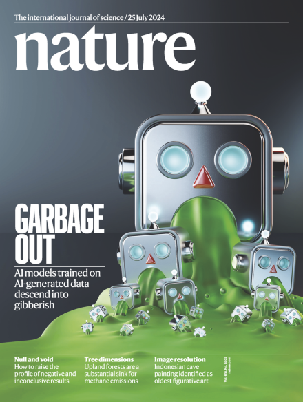
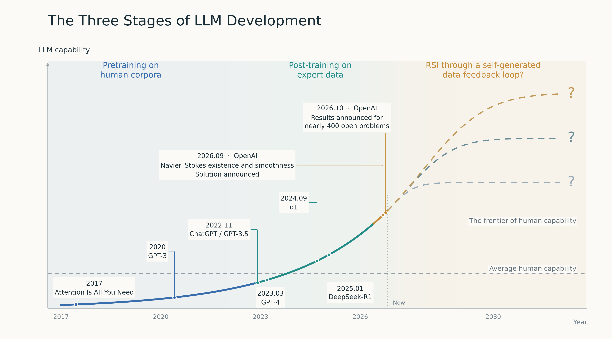
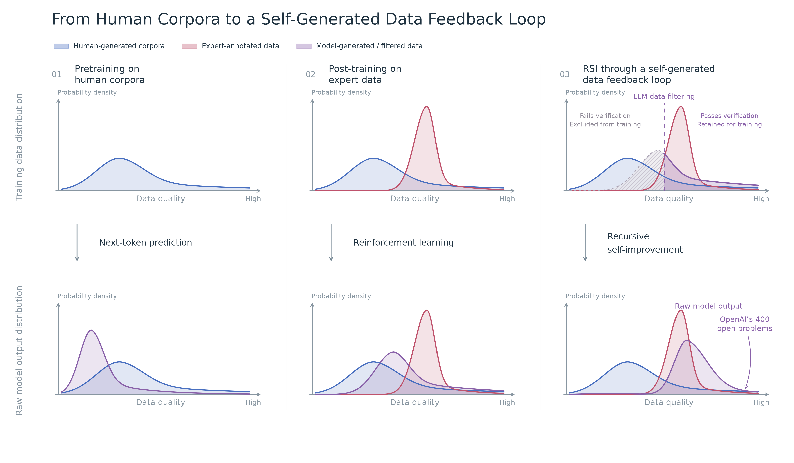
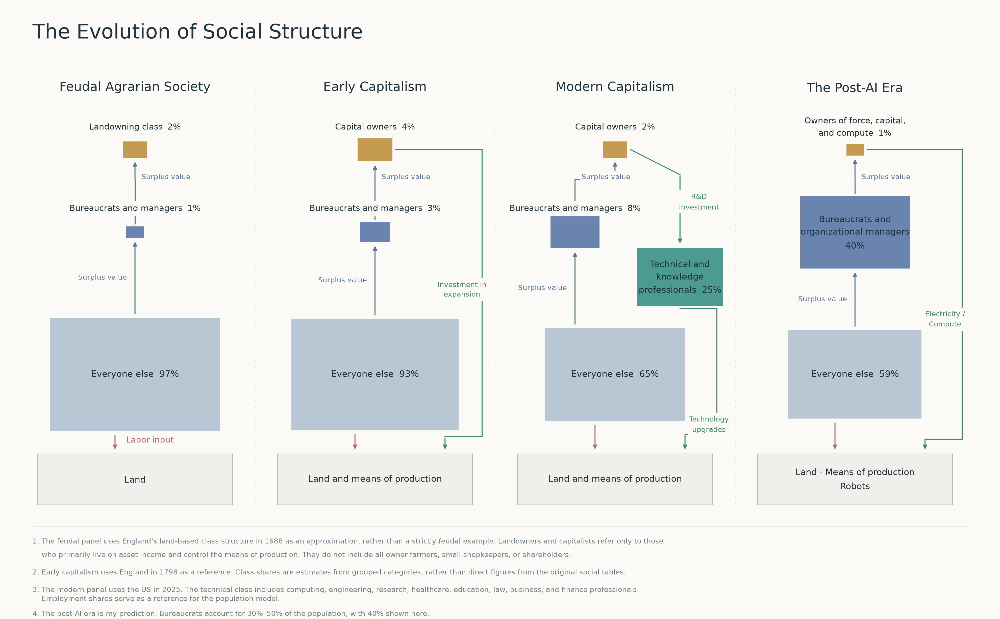

This essay centers on three ideas:

1. AI’s ability to filter and clean its own data is the foundation of recursive self-improvement (RSI).
2. AI that outperforms most people intellectually will bring about a worldwide “Saudi-fication.”
3. My own bewilderment as a 做题蛆 (problem-solving drone, a derogatory term for meritocrats shaped by an exam-oriented education system) in the post-AI era.

## Why AI Can Keep Improving Through Its Own Outputs

Many of you probably remember the cover of the July 25, 2024 issue of *Nature*: a robot spewing green vomit, which is then fed to subsequent generations of models, making them progressively worse. The phenomenon studied is called model collapse: indiscriminately training later models on data generated by earlier AI models causes them to lose information about the original data distribution from one generation to the next, degrading both the quality and the diversity of their outputs.

The idea is intuitive, and reassuring. After all, “How could AI possibly pull itself up by its own bootstraps and keep getting smarter?” Unfortunately, recent developments in recursive self-improvement have shattered that view. AI really can improve itself without human intervention.

The key to this shift lies in the word “indiscriminately” in “indiscriminately training later models on data generated by earlier AI models.” AI’s ability to filter and clean its own data is the foundation of RSI.

A basic fact is that checking whether a proof is correct is relatively easy compared with solving a difficult mathematical problem from scratch. If a model can verify proofs, it can keep proposing approaches to a problem and checking them one by one until it finds a correct one. If it cannot, it can move on to an easier problem. That correct reasoning path can then become a path rewarded in the model’s next round of training. In other words, the model has cleaned its own data. In fact, this is also why OpenAI has recently been working through open problems in mathematics, theoretical computer science, and theoretical physics as training data.

With this understanding, we can divide the development of large language models (LLMs) into three stages:

1. Pretraining on human corpora: learning linguistic reasoning abilities from the existing textual output of human civilization.
2. Post-training on expert data: learning human taste and the ability to plan long tasks, such as tackling complex scientific problems or coding large projects, from expert-annotated data.
3. RSI through a self-generated data feedback loop: moving beyond the frontier of human capability by having AI verify and clean its own data. (Chinese models reached the stage of using stronger models to verify and clean data ahead of everyone else, achieving RSI even earlier. We win!)

*This figure was drawn by ChatGPT, so it seems only fitting that Anthropic’s contributions are missing.*

The figure above includes a personal assumption: RSI, too, will have a ceiling. Just as exponential growth in nature is only an approximation that holds before limiting factors become apparent, this resembles the S-shaped population growth model we learned in high school. But that ceiling will necessarily lie above the frontier of human capability.

*AI’s filtering of its own training data also partly explains why it’s getting worse at talking like a normal person.*

This account of RSI focuses mainly on data. Another way to understand it is to let models improve their own architectures, as in the metamodels Ziming Liu is working on.

As I understand it, the upper bound on a model’s capabilities is determined by the data used to train it. Architectural innovations allow companies to use less compute and compress the data into smaller models, but they cannot break through the capability ceiling imposed by the data. Given unlimited compute, an extremely wide and deep fully connected network should be able to spontaneously develop structures resembling attention.

Judging by the current mix of roles in foundation-model training, data matters far more than architecture. In RSI, the role of large models in filtering their own data also far outweighs their role in optimizing their own architectures. Of course, with a pie as enormous as LLMs, improvements anywhere can bring substantial returns.

## The Social Impact of RSI

What would it mean for our society if intelligence exceeding the capabilities of most humans were available for little more than the marginal cost of electricity? I think the technical class as a whole would exit human society, leaving a new social structure with three layers: a ruling group that monopolizes force and compute, a vast bureaucracy serving that group, and robots and workers performing manual labor. The analogy is today’s oil states in the Middle East: princes who monopolize oil revenues, citizens living on benefits, and South Asian migrant workers doing the hard labor. You may already have noticed that this looks rather like feudalism. Let us take a look back at history.

Go back to 1769. Why did capitalism replace feudalism? In the agrarian era, land and labor were the only two factors of production, and land could not be reproduced. After the Industrial Revolution, the factors were the means of production and labor, and the means of production could be reproduced. Capitalists and landlords both hired workers. But while landlords spent all their surplus value on enjoyment and maintaining their rule, capitalists devoted some of it to reproducing the means of production and human capital, and invested in new technologies that might raise productivity.

Once the accumulation of the means of production reached saturation, capitalists first decided to try their luck overseas. That was imperialism. Later, finding that this road led nowhere, they decided to devote most of the surplus value to developing advanced technologies and organizational methods, a smaller portion to maintaining bloated public organizations whose staff merely appeared to be working, and a little more to providing a safety net for those at the bottom. The countries that chose to spend most of their surplus value maintaining bureaucracies went bankrupt after the Cold War. This pattern of distribution created demand for engineers, white-collar workers, and scientists, encouraged the reproduction of human capital, and gave us the capitalism we see today.

In the past, every industry required both labor and capital. Industries could be classified as labor-intensive or capital-intensive according to their relative demand for the two. In a future where RSI, and eventually embodied intelligence, have been achieved, perhaps every industry will need only a little labor and a great deal of capital: the existing kinds of means of production, plus AI tokens produced from electricity. The reproduction of human capital would then cease to be necessary. Investment in technological progress would become part of the AI giants’ capital expenditure, no longer creating jobs for humans.

We may therefore see the world undergo “Saudi-fication”: a handful of “princes” monopolize force, capital, and compute, a group of organizational managers get a share of the spoils through one connection or another while pretending to work, and everyone else lives mainly on subsistence benefits supported by the unprecedented material output AI makes possible. There is no fundamental difference between the second and third groups, really. After all, to paraphrase the world’s richest man, Mr. Musk, all humans need to do is wait for retirement and take up a hobby like gardening.

## If Thinking Becomes Cheap, What Kind of Person Do I Want to Be?

First, there is the question of my career. At least up until two years ago, my plan was to join the technical class and make a living from expertise in some particular field. Unfortunately, the solution of 400 open problems marks the death of mathematics, theoretical computer science, and theoretical physics. What I do see is that the strongest students in each of the three cohorts ahead of mine in my field have all switched tracks. One senior student watched OpenAI demolish an open problem he had followed and tried to solve for years. Disheartened, he decided to go into quant finance and make some quick money. Another saw the enormous disruption LLMs were bringing to physics and decided to join a frontier lab to see what they were doing. Of course, I am also envious of the big results I keep hearing rumors about.

The more profound impact is on my sense of identity. What I used to seek was a degree of freedom, and that freedom rested on a certain “irreplaceability”: only I could do this particular thing, so you needed me, and that put us on relatively equal footing. Of course, perhaps that was just a cover for my own particular brand of hired-hand thinking. Hahaha. But now our AI overlords can do all the work I can do. That forces me to pay more attention to the qualities that are uniquely mine as a person: how to connect with others, how to help more people, and how to expand my personal influence, otherwise known as self-promotion.

I had wanted to write much more: about my internal struggles, my final decision, whether to jump ship, and my views on the two industries… But plans never keep up with change. Many decisions I thought I had already made are now uncertain again.

So here is to all my fellow problem-solving drones who once hoped to join the technical class and now find themselves adrift. May we find a place for ourselves in this new era!
